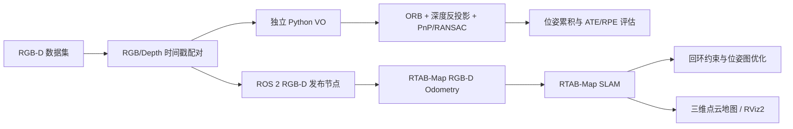
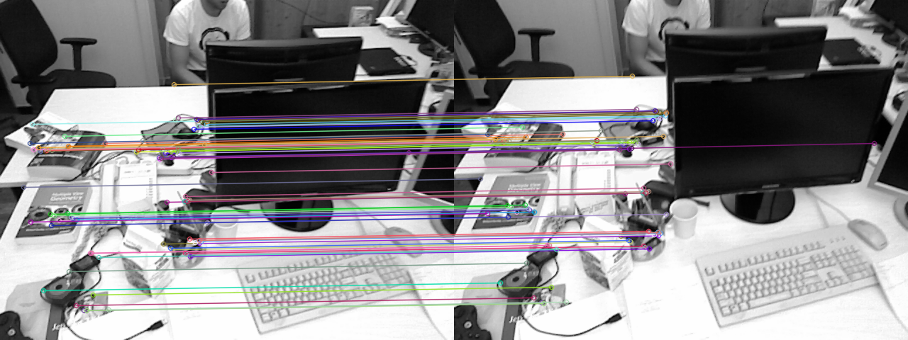
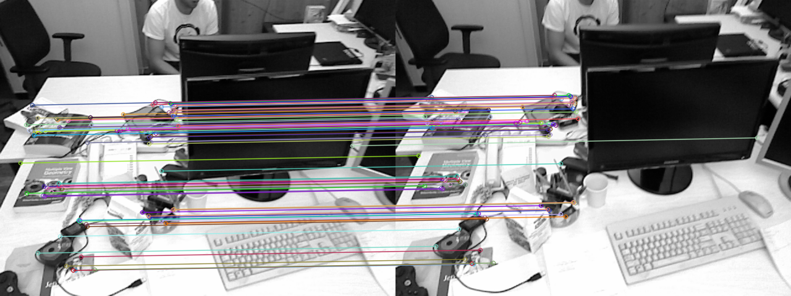
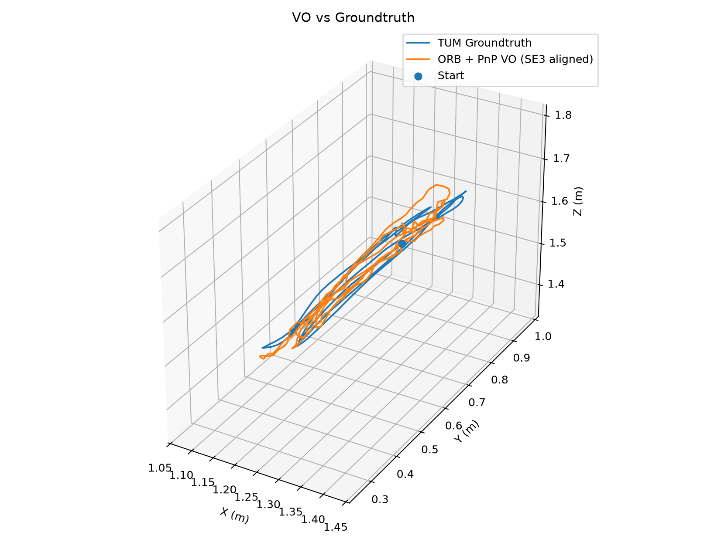
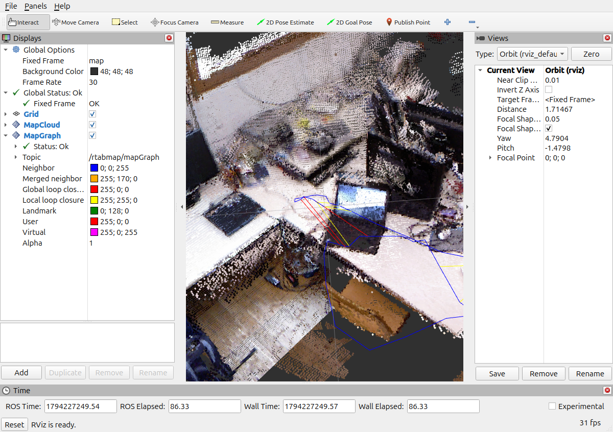
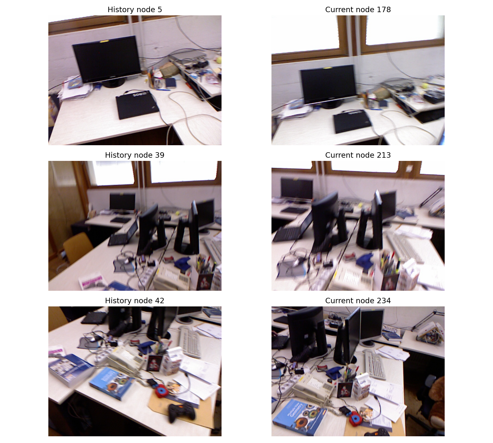
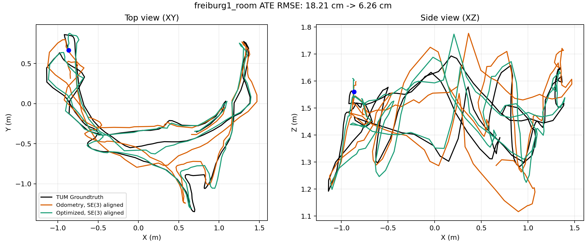
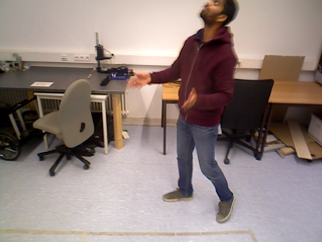
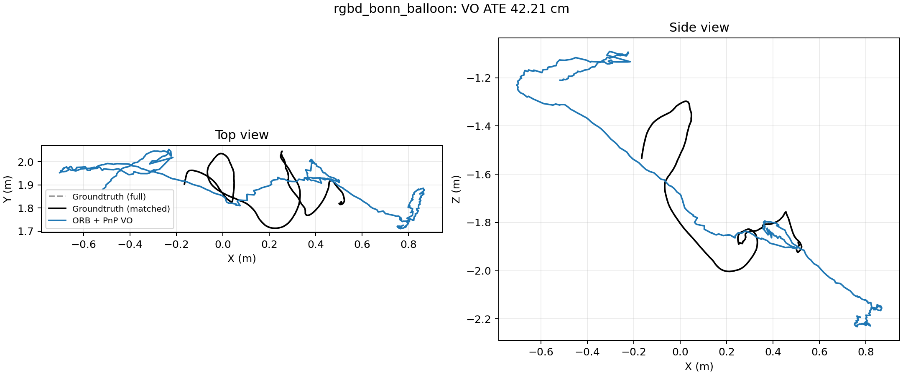
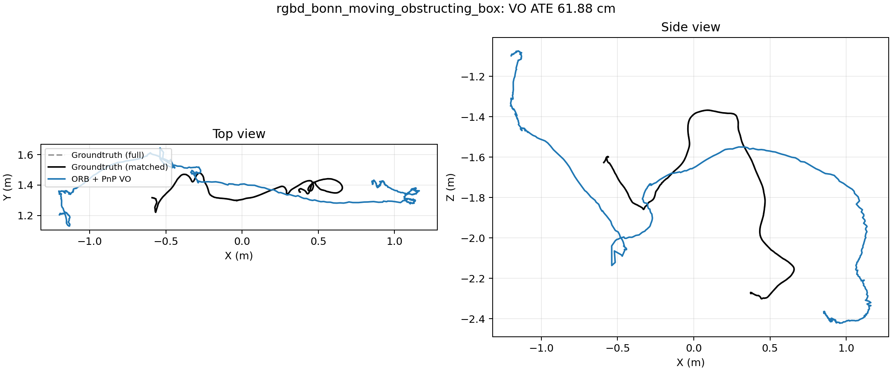

# RGB-D Visual Odometry & SLAM

**基于 RGB-D 的视觉里程计与室内 SLAM 系统**

使用 OpenCV 实现 ORB 特征匹配、深度反投影、PnP + RANSAC 和多帧位姿累积；使用 ROS 2 Jazzy 与 RTAB-Map 完成 RGB-D 里程计、三维建图、回环检测及位姿图优化。TUM RGB-D 用于静态室内轨迹评估，Bonn RGB-D Dynamic Dataset 用于动态物体与遮挡测试。

## 系统流程



独立 Python VO 与 RTAB-Map 自带的 RGB-D Odometry 是**两条独立实验流程**。Python VO 的位姿不作为 RTAB-Map 的输入。ROS 路径中的 TF2 链为 `map → odom → camera_optical_frame`。

## 项目结构

```text
RGBD_Visual_SLAM/
├── README.md / requirements.txt / .gitignore
├── test_orb.py                  # 两帧 ORB 匹配可视化
├── test_pnp.py                  # 两帧深度反投影、PnP/RANSAC
├── visual_odometry.py          # 多帧位姿累积、逐帧匹配质量
├── evaluate_trajectory.py      # TUM/Bonn VO 的时间关联、ATE/RPE
├── evaluate_rtabmap_room.py    # 已完成的 room 数据库回环与图优化分析
├── evaluate_bonn_slam.py       # Bonn 数据库与时间戳映射评估
├── rtabmap.rviz                # RViz2 显示配置
├── src/rgbd_slam_ros/
│   ├── rgbd_slam_ros/tum_rgbd_publisher.py  # TUM/Bonn RGB-D 发布
│   ├── launch/tum_rgbd_slam.launch.py       # Odometry + SLAM 启动
│   ├── package.xml / setup.py / setup.cfg
│   └── resource/
├── data/                       # 本地数据集，Git 不上传
└── outputs/                    # 本地实验档案；Git 仅收录精选图和摘要
```

根目录早期独立发布脚本已备份到本地 `outputs/local_archive/`；ROS 2 实际入口始终位于功能包内。`build/`、`install/`、`log/`、数据库、原始数据、完整日志与缓存都不会上传。

## 环境与数据

验证环境：Ubuntu 24.04、Python 3.12、ROS 2 **Jazzy**、OpenCV 4.6、NumPy 1.26、Matplotlib 3.6、RTAB-Map ROS 2、RViz2。`requirements.txt` 只供**独立 Python 实验**使用；ROS 节点使用 Jazzy 的系统 Python 和 `cv_bridge`。当前代码没有导入 Open3D，因此无需为复现本仓库安装它。

```bash
cd ~/RGBD_Visual_SLAM
sudo apt install python3-venv
python3 -m venv .venv
source .venv/bin/activate
python -m pip install -r requirements.txt
deactivate
```

ROS 2 依赖建议用 apt/rosdep 安装，不要把虚拟环境中的 pip 版 OpenCV 混入 ROS 进程：

```bash
source /opt/ros/jazzy/setup.bash
sudo apt install python3-opencv python3-numpy ros-jazzy-rtabmap-ros ros-jazzy-cv-bridge ros-jazzy-rviz2
rosdep install --from-paths src --ignore-src -r -y
```

- [TUM RGB-D Dataset](https://cvg.cit.tum.de/data/datasets/rgbd-dataset)：将 `rgbd_dataset_freiburg1_xyz`、`rgbd_dataset_freiburg1_room` 分别解压到 `data/`。每个目录应有 `rgb.txt`、`depth.txt`、`groundtruth.txt`、`rgb/`、`depth/`。
- [Bonn RGB-D Dynamic Dataset](https://www.ipb.uni-bonn.de/data/rgbd-dynamic-dataset/)：本项目使用 `rgbd_bonn_balloon` 和 `rgbd_bonn_moving_obstructing_box`，分别解压到 `data/` 下同名目录。只需下载所需序列，无需下载整个数据集。

原始数据不在 Git 仓库中。RGB 与深度按数据集时间戳找最近帧；TUM 格式 16 位深度 PNG 的 `5000` 对应 1 米。Bonn 模式采用官方 K、D，对已配准的 RGB 和深度应用相同校正映射，发布后 `CameraInfo.D=0`。Bonn 官网未明确下载的 PNG 是否已预先去畸变，因此这一校正是本实验明确记录的预处理假设。

## 运行：独立 Python VO

以下命令在仓库根目录执行。默认 `visual_odometry.py` 处理 Freiburg1 XYZ 的前 200 个候选帧、步长 2；`--max-frames 0 --frame-step 1` 表示处理完整配对序列。

```bash
cd ~/RGBD_Visual_SLAM
source .venv/bin/activate
python test_orb.py --dataset data/rgbd_dataset_freiburg1_xyz
python test_pnp.py --dataset data/rgbd_dataset_freiburg1_xyz
python visual_odometry.py --dataset data/rgbd_dataset_freiburg1_xyz --output-dir outputs
python evaluate_trajectory.py --dataset data/rgbd_dataset_freiburg1_xyz --output-dir outputs
```

Bonn 需要指定相机配置和单独输出目录，避免覆盖 TUM 结果：

```bash
python visual_odometry.py --dataset data/rgbd_bonn_balloon --camera-profile bonn --max-frames 0 --frame-step 1 --output-dir outputs/bonn_eval/balloon_new
python evaluate_trajectory.py --dataset data/rgbd_bonn_balloon --groundtruth-profile bonn --output-dir outputs/bonn_eval/balloon_new
```

把上面两条命令中的 `rgbd_bonn_balloon` 改为 `rgbd_bonn_moving_obstructing_box`、`balloon_new` 改为 `moving_obstructing_box_new`，可运行遮挡序列。`evaluate_trajectory.py` 按最近 Groundtruth 时间戳匹配并以 SE(3) 刚体对齐，**不进行尺度修正**；失败帧及轨迹覆盖率分别记录在 CSV/JSON 中。

## 运行：ROS 2 + RTAB-Map

终端 1：编译并播放 TUM room。每次完整实验使用**新的数据库路径**；`max_frames:=0` 不截断配对序列，`hz:=5` 只控制播放速度。

```bash
cd ~/RGBD_Visual_SLAM
source /opt/ros/jazzy/setup.bash
colcon build --packages-select rgbd_slam_ros --symlink-install
source install/setup.bash
ros2 launch rgbd_slam_ros tum_rgbd_slam.launch.py \
  dataset:=$PWD/data/rgbd_dataset_freiburg1_room \
  camera_profile:=tum \
  database_path:=$PWD/outputs/rtabmap_room_new.db \
  stamp_map_path:=$PWD/outputs/room_new_stamp_map.csv \
  hz:=5 max_frames:=0
```

终端 2：在播放期间查看地图。该 Launch 保持已验证的 Reliable QoS 与 RGB、Depth、CameraInfo 精确时间同步；里程计发布 `odom → camera_optical_frame`，SLAM 发布 `map → odom`。

```bash
cd ~/RGBD_Visual_SLAM
source /opt/ros/jazzy/setup.bash
source install/setup.bash
rviz2 -d rtabmap.rviz
```

Bonn 运行时，终端 1 中的 Launch 改为：

```bash
ros2 launch rgbd_slam_ros tum_rgbd_slam.launch.py \
  dataset:=$PWD/data/rgbd_bonn_balloon camera_profile:=bonn \
  always_process_most_recent_frame:=false \
  stamp_map_path:=$PWD/outputs/bonn_eval/balloon_new/stamp_map.csv \
  database_path:=$PWD/outputs/bonn_eval/balloon_new/rtabmap.db \
  hz:=5 max_frames:=0 2>&1 | tee outputs/bonn_eval/balloon_new/rtabmap.log
```

先执行 `mkdir -p outputs/bonn_eval/balloon_new`。改用遮挡序列时同时把数据目录和输出目录换为 `rgbd_bonn_moving_obstructing_box` 与 `moving_obstructing_box_new`。播放结束后，在已加载 Jazzy 的终端中评估同一数据库的原始与优化后图节点轨迹：

```bash
python3 evaluate_bonn_slam.py \
  --dataset data/rgbd_bonn_balloon \
  --database outputs/bonn_eval/balloon_new/rtabmap.db \
  --stamp-map outputs/bonn_eval/balloon_new/stamp_map.csv \
  --output-dir outputs/bonn_eval/balloon_new
```

需要逐终端的两组完整命令、时间戳映射方法与质量统计时，请看 [Bonn 实验报告](outputs/bonn_eval/report.md)。TUM room 的已完成数据库评估方法见 [room 实验报告](outputs/rtabmap_room_eval/report.md)；本仓库不上传该 `.db` 和完整日志，复算原报告需要本地保存的同批实验文件。

## 实验结果

### TUM：视觉里程计与室内 SLAM

Freiburg1 XYZ 的独立 Python VO：200 帧实验 ATE 平移 RMSE **4.41 cm**。Freiburg1 room 的 RTAB-Map 完整实验发布 1362 对 RGB-D，数据库保存 239 个节点；同一数据库导出的 174 个有效图节点用于优化前后比较。

| Freiburg1 room 指标 | 实测 |
|---|---:|
| 全局视觉回环约束 | 14 |
| 局部空间约束 | 19 |
| ATE 平移 RMSE：原始里程计 → 完整图优化 | 18.21 → 6.26 cm |
| ATE 降幅 | 65.63% |

该降幅是包含相邻里程计、全局视觉回环及局部空间约束的**完整位姿图优化效果**，不能全部归因于 14 条全局回环。

| ORB 特征匹配 | PnP/RANSAC 内点 |
|:---:|:---:|
|  |  |

| Python VO 与真值轨迹 | RTAB-Map 室内地图 |
|:---:|:---:|
|  |  |

| 代表性回环历史场景 | 图优化前后轨迹 |
|:---:|:---:|
|  |  |

### Bonn：动态场景鲁棒性

两组完整序列均已真实运行。离线 VO 的有效位姿覆盖全部成功配对 RGB-D 帧；ROS 里程计日志各有一次启动阶段 `quality=0`，之后没有持续跟踪丢失。数据库未接受全局视觉回环，因此优化前后的小幅差异不能解释成全局回环收益。

| 指标 | balloon | moving_obstructing_box |
|---|---:|---:|
| 原始 RGB / 成功配对 | 439 / 438 | 590 / 590 |
| 独立 VO 有效位姿 / 跟踪失败 | 438 / 0 | 590 / 0 |
| 独立 VO ATE 平移 RMSE | 42.21 cm（438 帧） | 61.88 cm（589 帧） |
| RTAB-Map 数据库节点 / 有效评估图节点 | 78 / 23 | 106 / 42 |
| 图节点 ATE：原始 → 优化后 | 15.18 → 11.99 cm | 63.09 → 57.90 cm |
| 接受的全局回环 | 0 | 0 |

| balloon：动态人物与轨迹 | moving_obstructing_box：遮挡与轨迹 |
|:---:|:---:|
|   |   |

动态人物和纸箱使局部特征与 RANSAC 内点数明显下降；balloon 地图中可见运动物体多位置重影。两条序列的轨迹不同，不应仅根据 ATE 大小判断动态因素的相对严重程度。ROS 地图截图和 SLAM 轨迹图保存在各自实验目录中。

## 项目收获与边界

- RGB-D 深度提供米制 3D 点，PnP/RANSAC 估计相邻相机运动；逐帧误差会在位姿累积中传播。
- RTAB-Map 根据外观与几何验证建立回环约束，图优化可校正长期漂移；接受的约束类型应从数据库核查。
- ROS 2 的 QoS 与三路消息时间戳一致性会直接影响进入 Odometry 和 SLAM 的帧数。
- 运动物体可能降低匹配质量并在静态地图中产生重影。本项目未加入语义分割或动态物体剔除，也没有动态场景的静态基线对照。
- 原始数据、完整日志和地图数据库留在本地；GitHub 只保存可展示的图和轻量指标。运行新实验请使用新输出目录，避免覆盖报告对应的原始成果。
